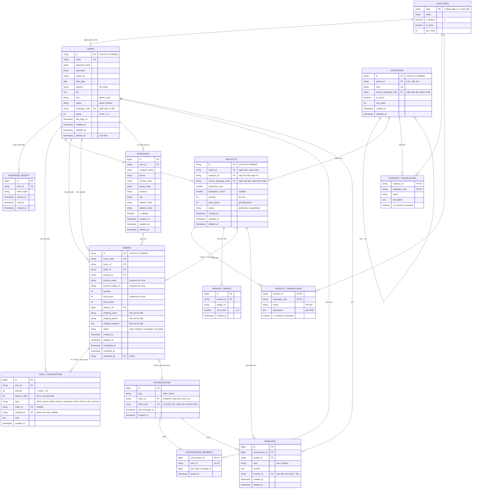

# Sơ đồ ER – Ứng dụng mua bán tem bưu điện cũ

Nguồn yêu cầu: Google Sheet *function list* (Overview, Admin, App).
Phiên bản: v0.4 (10/10/2026), dùng point thay tiền, người bán được cộng point, chỉ admin huỷ đơn, trước mắt chỉ làm tiếng Việt.
Stack: BE Golang · Admin FE React (Node.js) · Mobile Flutter · DB PostgreSQL 17.
Schema thực tế: `backend/migrations/000001_init.up.sql`.

## 1. Sơ đồ

## 2. Trạng thái đơn hàng

Chỉ có một cột `orders.status`; mỗi phía hiển thị nhãn khác nhau.

| `status` | Người bán thấy | Người mua thấy | Chuyển trạng thái |
|---|---|---|---|
| `paid` | Đã thanh toán + **[GIAO HÀNG]** | Chờ giao hàng | Người bán bấm GIAO HÀNG → `shipped` |
| `shipped` | Đã giao hàng | Chờ giao hàng + **[ĐÃ NHẬN HÀNG]** | Người mua bấm ĐÃ NHẬN HÀNG → `completed` |
| `completed` | Hoàn thành | Đã nhận hàng | Kết thúc |
| `cancelled` | Đã hủy | Đã hủy | Chỉ **admin** huỷ, ở **mọi** trạng thái |

Dòng point theo từng bước:

| Thời điểm | Người mua | Người bán | Tồn kho |
|---|---|---|---|
| Tạo đơn | − `total_points` (`purchase`) | | − `quantity` |
| Hoàn thành | | + `total_points` (`sale`) | |
| Admin huỷ khi `paid` / `shipped` | + `total_points` (`refund`) | | + `quantity` |
| Admin huỷ khi `completed` | + `total_points` (`refund`) | − `total_points` (`sale_reversal`) | + `quantity` |

Nếu đơn đã hoàn thành mà số point hiện có của người bán nhỏ hơn `total_points` (đã tiêu point vừa nhận), **không cho huỷ** và API báo lỗi cho admin.

## 3. Đối chiếu chức năng ↔ bảng

| Chức năng | Phía | Bảng sử dụng |
|---|---|---|
| Login email/password | Admin, App | `users` (`role` để phân biệt admin/user), cập nhật `last_login_at` |
| Register | App | `users` |
| Forgot password | App | `password_resets` |
| Setting: đổi mật khẩu | App | `users.password_hash` |
| Quản lý user (list/create/edit/delete) | Admin | `users` (xoá mềm qua `deleted_at`) |
| Cấp point cho user (user detail) | Admin | `users.points` + `point_transactions` (`admin_grant`, `created_by` = admin) |
| Quản lý category cha/con | Admin | `categories` (`parent_id`), `category_translations` |
| Product list / create / delete | Admin, App | `products` (`price_points`), `product_translations`, `product_images` |
| Publish / Unpublish | Admin, App | `products.status` |
| Trạng thái tồn kho | Admin, App | Tính từ `products.quantity` (xem mục 4) |
| Mua tem | App | Trong 1 transaction: trừ `products.quantity`, trừ `users.points` người mua, ghi `point_transactions` (`purchase`), tạo `orders` + `conversations` |
| List / detail đã bán, đã mua | App | `orders` lọc theo `seller_id` / `buyer_id` (đã có snapshot ảnh, tên tem, số lượng, point) |
| Chat theo đơn hàng | App, Admin xem | `conversations` (`type = order`) + 2 `conversation_members`. Admin đọc theo `role`, không gửi được |
| Chat tự do + đính kèm tem | App | `conversations` theo `direct_key`; tin đầu tiên `messages.type = product` với `product_id` để hiện ảnh + tên tem |
| Quản lý địa chỉ (tạo nhiều) | App | `addresses` (`is_default`) |
| Thống kê: top 10 user bán nhiều nhất | Admin | `SUM(orders.quantity)` theo `seller_id`, chỉ đơn `completed` |
| Thống kê: tổng point giao dịch | Admin | `SUM(orders.total_points)`, chỉ đơn `completed`, nhóm theo ngày/tháng |
| Thống kê: tỷ lệ theo category | Admin | `orders` → `products.category_id` (gộp về category cha nếu cần) |
| Thống kê cá nhân | App | Như trên nhưng lọc theo user đang login |

## 4. Quyết định thiết kế

- **ID của `users`, `categories`, `products`, `orders`** gồm 5 chữ cái in hoa ngẫu nhiên + ngày tạo `YYYYMMDD` theo giờ Việt Nam, ví dụ `KQZMB20261010` (`VARCHAR(13)`, DB kiểm tra định dạng). API sinh ID khi tạo (`internal/ids`); các bảng phụ vẫn dùng `bigint`. Áp dụng từ migration `000002_string_ids`.
- **Một bảng `users` cho cả admin và user**, phân biệt bằng `role`.
- **Point thay cho tiền.** `users.points` là số dư (DB chặn âm). Mọi thay đổi số dư đều ghi một dòng `point_transactions` kèm `balance_after`, để tra soát khi có khiếu nại. Không có bảng thanh toán.
- **Trạng thái tồn kho không lưu thành cột riêng** mà tính từ `quantity`: `0` là hết hàng, `1–5` là sắp hết, `> 5` là còn hàng. Ngưỡng **cố định là 5**, đặt thành hằng số trong code.
- **Category 2 cấp** qua `parent_id`; quy tắc "con không được có con" kiểm tra ở API. Tem gắn được vào **cả category cha lẫn con**.
- **Đa ngôn ngữ, giai đoạn 1 chỉ có tiếng Việt**: bảng `languages` chỉ bật `vi` (mặc định); `en`, `ja` có sẵn nhưng đang tắt. Chuỗi giao diện tĩnh (label, nút…) để trong file ngôn ngữ riêng của web-admin và Flutter, hiện chỉ có file `vi`.
- **Khi làm tự dịch (giai đoạn sau)**: người dùng nhập nội dung bằng một ngôn ngữ (`source_language_code`), hệ thống dịch sang các ngôn ngữ đang bật và đánh dấu `is_machine_translated = true`. Thêm quốc gia mới chỉ cần thêm dòng vào `languages`, không phải sửa schema. Thiếu bản dịch thì fallback về ngôn ngữ mặc định.
- **Giới hạn tối đa 2 ảnh/tem** được DB chặn (`sort_order` 1–2, unique theo tem).
- **Một đơn chỉ một loại tem**, nên bỏ bảng `order_items`. Đơn lưu snapshot tên, ảnh và giá point lúc mua.
- **Mua tem trong một transaction**: `UPDATE products SET quantity = quantity - n WHERE id = ? AND quantity >= n`, trừ point người mua, ghi lịch sử point, tạo đơn và phòng chat. Làm vậy để không bán quá tồn kho và không có đơn thiếu phòng chat.
- **Đơn hàng lưu bản sao địa chỉ giao hàng**, nên user sửa hoặc xoá địa chỉ sau đó thì đơn cũ vẫn đúng.
- **Một bảng `conversations` cho cả hai loại chat**; `order_id` UNIQUE và `direct_key` UNIQUE nên mỗi đơn và mỗi cặp user chỉ có đúng một phòng.
- **Chat không gửi ảnh**; chỉ có tin `text` và tin `product` (thẻ tem).
- **Admin xem chat nhưng không gửi được.**
- **Chỉ admin huỷ đơn**, ở mọi trạng thái. Huỷ đơn thì hoàn point cho người mua, trả lại tồn kho, và trừ lại point người bán nếu đơn đã hoàn thành. Tất cả trong một transaction.

## 5. Câu hỏi còn mở

1. **Dịch vụ tự dịch** (giai đoạn sau): Google Cloud Translation, DeepL hay Claude API?
